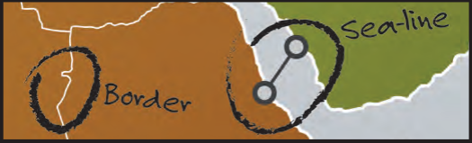
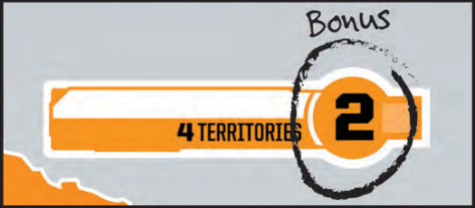
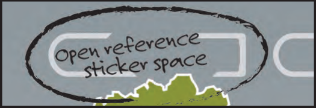
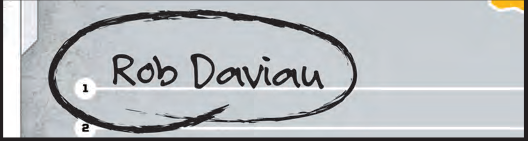
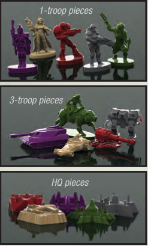
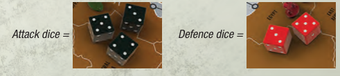

# A Look at the Components

<!-- page 4 -->

## GAMEBOARD

The game board is divided into 42 territories. Troops will go in these territories. Sometimes there will be many troops in a territory; sometimes none.

<!-- Page 4 shows the board through five callout boxes. Left column (top to bottom) first, then right column. The hand-lettered words in the pictures are transcribed in the image descriptions. -->

> Territories are connected either by a border or by a sea-line. Territories that are connected can attack each other. There is no difference between attacking over a sea line or across land.
>
> 

> Territories are grouped together into six different continents. The territories are marked in different colors to show which continent they belong to. If you control a whole continent at the start of your turn, you'll get bonus troops.
>
> 

> The top of the board defines the abilities of some of the marks. The game starts with two scars (Bunker and Ammo Shortage) and the fortification mark available. The blank spaces on the board will get filled in as you open envelopes.
>
> 

> Each territory has a shape showing you where to place marks in that territory. Scars connect to the lower half and cities connect to the upper half. By placing them on the symbols, you make sure that you don't accidentally put two scars in the same territory or cover up a name or put a sticker over a fold in the board, etc.
>
> 

> The final thing to note is the victor's section. The winners of the first 15 games on this board will get to sign this section and will receive a game-altering reward for winning.
>
> 

## FACTION CARDS

Each army comes with its own Faction card that will evolve as you play more games. The back of the card shows where each Faction started a game (if it was in that game) and whether it won, held on, or was eliminated.

<!-- page 5 -->

## PLASTIC PIECES

The plastic figures represent troops and HQs. There are two different types of troops: the single figure represents one troop; the vehicle/mounted figure represents three troops. It makes no difference if you put three single troops or one 3-troop piece in a territory - either option represents three troops.

The last plastic piece is a faction's HQ. Each HQ is worth one red star (you need 4 red stars to win the game so it is good to hold onto your HQ and to take other players').

## SIDEBOARD

This is the sideboard where you will place the different types of cards in the game. The sideboard helps you manage the cards. Place the sideboard to one side of the gameboard.

*Text printed in the illustration (second top slot):* The first time this pile is depleted in a game, the person who controls the most territories gains one [Red Star token icon]

## DICE

You have dice in two different colors. The 3 black dice are used when attacking. The 2 red dice are used when defending.

## RED STARS

These are used to keep track of Red Stars that players have earned in the game.

<!-- Illustration: a Red Star token (a dark round token with a red star). Decorative; not extracted. -->

## MISSILES

Players receive one missile for every game they have won in this world.

<!-- Illustration: a Missile token (an orange hexagonal token with a missile). Decorative; not extracted. -->

## CARDS

**RESOURCES/RESOURCE CARDS:** There are two types of resource cards in the game: Territory cards and Coin cards. They both have Coin symbols on them that represent resources.

**TERRITORY CARDS:** Each Territory card has a name of a territory on it and one Coin symbol on it at the start of the game. As you play more games, Territory cards will get more resources (Coins), up to a maximum of 6.

**COIN CARDS:** There are 10 Resource cards that only have the Coin symbol on them. These are Coin cards. Coin cards form a separate pile on the board and are never upgraded to have more than one resource (Coin) on them.

**SCAR CARDS:** Players will receive a Scar card before some games. These will allow the player to permanently alter a territory on the board or a Faction card.

**STARTING POWER CARDS:** These cards are used to give the Factions one starting power.

Other cards will come into play as you open the sealed components.

## STICKER SHEET

These marks are used before your first game and at the end of the first 15 games you play in this world.

<!-- Illustration: photo of the sticker sheet (Coin stickers and blue city-mark stickers). Labels too small to read; decorative; not extracted. -->

## SEALED COMPONENTS

Don't open these until you've earned the right to!

<!-- Illustration: four sealed cards, each closed with hazard-striped (yellow and black) seals at top and bottom. Their printed labels are transcribed below. -->

> **[Text printed on the sealed cards in the illustration, left to right]**
>
> 1. OPEN WHEN ALL 9 MINOR CITIES HAVE BEEN FOUNDED.
> 2. OPEN THE FIRST TIME A FACTION IS ELIMINATED FROM THE GAME.
> 3. OPEN WHEN ONE PERSON GETS TO SIGN THE BOARD FOR A SECOND TIME.
> 4. [small city-mark icon] OPEN WHEN THE WORLD CAPITAL MARK IS ABOUT TO GO ON THE BOARD.
