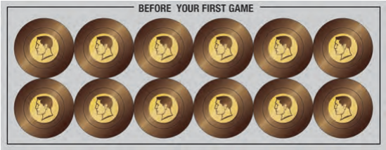

# Object of the Game and Before Your First Game

<!-- page 6 -->

## OBJECT OF THE GAME:

Be the first player to have 4 Red Stars, or (much more rarely) eliminate all the other players.

<!-- Left side of page 6: concept sketches captioned "Enclave of the Bear 3-army piece concepts" and "Enclave of the Bear HQ concepts". Decorative; not extracted. -->

## BEFORE YOUR FIRST GAME:

Before you start your first game you will customize your world and your factions. There's no right or wrong way to do this. You can think it through or do it randomly. One person can do it or it can be a group decision.

### Customize the Factions

*Text in the illustration:* The Faction card is titled "KAHN INDUSTRIES" and the Power card "KHAN INDUSTRIES". The circled power sticker reads "At the start of your turn, place one troop in each territory with a HQ you control." The crossed-out second sticker is partly hidden by the pen strokes; only fragments are legible ("When draw...", "...place one troop into that territory if you..."). Handwritten caption: "Pick one power and destroy the card."

Each Faction has two possible starting powers. Take the First Game Power cards and choose a starting power for each Faction. Remove the sticker from the card and put it onto the green space of the corresponding Faction card. Once each Faction has a starting power, DESTROY the remaining powers; they will not come into play in your version of the game. If you are stuck as how to customize the cards, flip a coin for each faction's starting power.

### Customize the Resource Deck

Each Territory card starts with one coin on it, showing it has one resource. The section on the sticker sheet marked BEFORE YOUR FIRST GAME contains 12 additional coins to be placed onto Territory cards.

Remove the 12 Coin stickers from the card and apply them to the Territory cards. You cannot increase a territory's starting resources beyond 3 before the first game (after the first game a territory card may be slowly increased to 6 resources).

*Note: Increasing a territory to 3 resources before the first game will make those territories hotly fought over. Keeping all of them at 1 or 2 resources will spread the board out. Similarly, increasing the value of the territories in one continent will make that continent very valuable whereas spreading out the resources will give the whole board its spots worth fighting over.*

There is no right or wrong way to do this but different choices will lead to a different flavor of game. If you can't decide, shuffle the Territory deck, and put one coin on the first 12 cards drawn randomly from the top.
