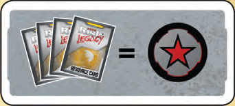

# Goal and Turn Overview

<!-- page 8 -->

## GOAL

You win immediately when you are the first player to have 4 Red Stars, or if all other players are eliminated.

Red stars can be gained in several ways:

- Players who have not yet won a game on this board start with one Red Star token.
- Every HQ you control counts as a Red Star. Taking over other players' HQs is one way to gain more red stars (note: you do not collect a Red Star from the pile, every HQ counts as a Red Star).
- Red Star tokens can be purchased at the start of your turn by turning in 4 Resource cards (regardless of the number of coins on those cards).

  

- There are other ways to gain Red Stars that will come into the game the more you play it. These will be explained at that time.

A player's current Red Star total is equal to the number of Red Stars he controls on the board, plus the number of Red Star tokens he has in front of him. Red Stars on the board (HQs and other things later in the game) can change hands many times in a game but Red Star tokens never change hands.

<!-- Illustration under the Goal panel: photo of five HQ models in faction colors. Decorative; not extracted. -->

## TURN OVERVIEW

Each player will take his turn using the following steps, in order. After a player has completed their turn, the player to the left takes his turn. Play then continues clockwise until someone either gains his 4th Red Star or has eliminated all other players.

1. Start of Turn
2. Join the War or Recruit Troops
3. Expand & Attack (optional)
4. Maneuver Troops (optional)
5. End of Turn

> **A NOTE ON TIMING:**
>
> There are some points where more than one player may want to play a scar card or a missile at the same time. If that happens, priority goes to the person who declared first. If it is unclear who declared first, then priority goes to the current player, then the defender (if in combat), then clockwise from the current player.
