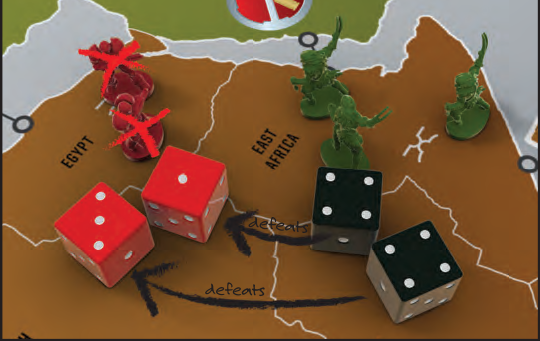
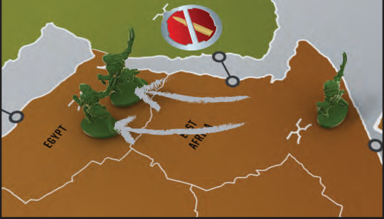
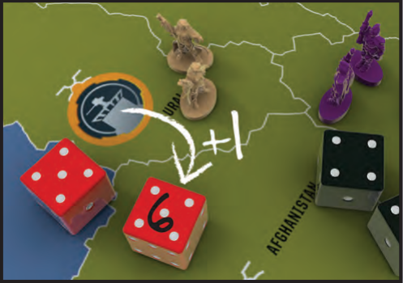
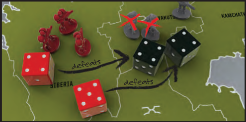
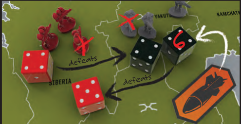

# Turn Step 3: Expand and Attack

<!-- page 10 -->

## ❸ EXPAND AND ATTACK (optional)

At this point, you can expand into unoccupied territories and/or attack adjacent enemy territories in an attempt to take control of them. Expanding and Attacking is optional. Just like standard Risk, you can expand and attack as much as you want, providing you have the troops to do so.

### EXPANDING INTO UNOCCUPIED TERRITORIES

Expanding into an unoccupied territory is straightforward – move at least 1 troop from an adjacent territory you control into the unoccupied territory. You now control this territory.

### EXPANDING INTO UNOCCUPIED CITIES

Expanding into an unoccupied territory that also contains a city (Minor, Major, or World Capital) is similar to expanding into an unoccupied territory, except that you have to contend with the entrenched resistance. When your troops move into one of these territories, you lose troops equal to the population of that city. If you would not have enough troops to keep control of the territory after losing these troops, you cannot expand into it.

*Note: Moving troops into a city territory that also has enemy troops in it is not expanding; it is attacking, and is handled like any other attack. You do not lose additional troops when moving into a city after taking it from another player.*

### ATTACKING ENEMIES

If you want to take control of a territory that contains enemy troops, you do not expand into it but, rather, attack it.

### HOW TO ATTACK

- Choose one of your territories that contain at least 2 troops. Select 1 troop to "stay behind" and guard your territory. The remaining troop(s) are eligible to attack the enemy territory.
- Choose how many troops will participate in this battle. You can send in 1, 2, or 3. Your attacking territory may contain more than 3 troops, but no more than 3 can attack at once.
- The defender chooses how many troops will defend- 1 or 2 troops.
- Each side rolls 1 die for each troop in the battle. This means the attacker rolls 1, 2, or 3 dice and the defender rolls 1 or 2 dice.
- Both sides put their dice in order from highest to lowest. Compare your highest die to your opponent's highest die. The higher number wins and the loser removes a troop from the territory. The defender wins ties.
- Now compare your second highest dice in the same way. The loser removes a troop from the territory.
- If there is no die to compare yours to, meaning you rolled 1 or 2 more dice than your opponent, then ignore that die/dice.

<!-- Page 10 art, bottom left: concept sketch captioned "Imperial Balkanian 3-army piece concept". Decorative; not extracted. -->

<!-- Right column of page 10: an attack example in three illustrated panels (caption box plus photo each). -->

> **[Illustrated example, panel 1 of 3]**
>
> Enclave of the Bear in East Africa is attacking Die Mechaniker in Egypt. Enclave sends in the maximum three troops and Die Mechaniker defends with the maximum two. The highest attack die is a 5, as is the highest defense die. The defender wins ties so Enclave loses an attacker. The second highest dice are an attacker's 4 and a defender's 3. The attacker wins and Die Mechaniker loses a defender.
>
> 

> **[Illustrated example, panel 2 of 3]**
>
> Enclave of the Bear can only send in two attackers since one must stay behind. The defender can defend to the last man. Both players roll 2 dice. In this case both the attacker's dice are higher than the defender's dice so Die Mechaniker loses his remaining two defenders.
>
> 

> **[Illustrated example, panel 3 of 3]**
>
> Enclave must now move his two attacking troops into the empty territory. If he had more troops in East Africa to move in, he could move them at this time. He cannot move in with his last troop as he would be abandoning that territory.
>
> 

<!-- page 11 -->

### MODIFYING DIE ROLLS

Some marks on the board as well as missiles and special powers on faction cards may change the value of certain die rolls. The effects of marks are listed on reference stickers on the game board. The following rules are in effect for all die modifications in combat:

1. Whether you are increasing or decreasing a die roll, the roll can never be higher than 6, or lower than 1.
2. If more than one die is the same number, only one is modified per Scar, Faction Power, or Missile. For example: If you are defending in a territory with a bunker and roll two 5s, only one would change to a 6 because of the bunker in your defending territory.

   

3. Sometimes, a combination of Scars, Missiles and special powers on Faction cards may affect which die is the highest one. Reevaluate your dice after all modifiers have been triggered to see which is now the highest.

### FORTIFICATIONS

Fortifications are energy shields that protect a city against offensive assaults. *A territory with a Fortified city costs two additional troops to expand into if unoccupied.*

When defending a territory with a Fortified city, the defender adds 1 to both of his dice. If the attacker attacks with 3 troops, the fortification gets worn down. After each attack with 3 troops, mark one of the boxes around the Fortification. Once all 10 boxes have been marked, that city is no longer considered fortified. A Fortified city (or one with a partially depleted or fully depleted Fortification) can always be re-fortified with a new Fortification mark. Any remaining uses on the old Fortification are wasted.

### MISSILES

In future games, some players may have one or more Missile tokens. These tokens can be discarded to affect die rolls in combat as noted below.

Any player (even those not involved in the battle) may discard Missile(s) after dice are rolled, but before troops are removed. For each Missile discarded in this way, the player can change one die in the combat roll to an unmodifiable 6. A player may discard multiple Missiles to change multiple dice per battle.

Players may discard Missiles in any order and may respond to another player using a Missile by using a second (or more). If two or more players are trying to play a Missile at the same time, priority goes to the current player (attacker), then the defender, then each player clockwise around the table from the attacker.

> **[Illustrated example, panel 1 of 3]**
>
> While attacking Siberia, Khan Industries is about to lose two troops to Die Mechaniker.
>
> 

> **[Illustrated example, panel 2 of 3]**
>
> Desperate for this win, the Khan Industries player plays a Missile, changing one attack die to a 6, changing the results of the battle to one casualty each.
>
> 

> **[Illustrated example, panel 3 of 3]**
>
> Imperial Balkania, who is not even in the battle, wants the defender to win and plays a Missile, changing one defender die to a six. This means that Khan Industries will lose both attacking troops.
>
> 

<!-- page 12 -->

### IF THE DEFENDER HAS NO MORE TROOPS IN THE TERRITORY

Move the attacking troops into the territory. You may also move in additional troops from the attacking territory at this time. So even though you can only attack with a maximum of 3 troops, you can move more than that into the conquered territory so long as you leave at least one troop behind. No territory can ever be left abandoned because all the troops moved into a new territory.

If the conquered territory has an enemy HQ, leave the HQ in the territory. You now control that HQ and the Red Star that it is worth. If this gives you your fourth Red Star, then you win the game.

You may attack more territories if you like and are able to.

### IF THE DEFENDER STILL HAS TROOPS IN THE TERRITORY

You may attack again if you like and are able to, either between the same territories or between new ones.

### KNOCKING OUT ANOTHER PLAYER

You knock out another player if you defeat his last troop on the board. As a reward, you get all of that player's resource cards, but not his Scar card or Red Star/Missile tokens if he has any. Depending on the state of the board, this player may or may not be able to Join the War at the start of his next turn.

<!-- Sticker image for the next box: assets/unlocks/eliminated/rules/images/pg12PanelE.jpg -->

> **[Rule sticker space — intentionally blank]**
>
> *Rules addition E will go here.*
