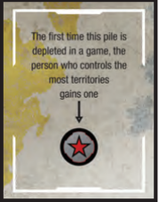

# Turn Steps 4 and 5: Maneuver Troops; End of Turn

<!-- page 12 (continued) -->

<!-- Page 12 opens with step 3 sub-sections (see 07-turn-step-3-expand-and-attack.md). Steps 4 and 5 are in the lower half of the left column; DRAWING A CARD and WHEN THE DECK OF COIN CARDS RUNS OUT are in the right column. -->

## ❹ MANEUVER TROOPS (optional)

After you have finished with expansions and attacks, you may maneuver your troops. Maneuvering troops is optional.

Unless you have a power that says otherwise, you can only perform one maneuver per turn.

How to maneuver: take as many troops as you'd like from one of your territories and move them to one other connected territory. Territories are considered connected if all of the territories in between are also controlled by you. You cannot pass through enemy or empty territories, and you must always leave at least 1 troop behind in the origin territory.

This is not an attack or an expansion; it is simply a movement from one of your territories to another one in order to protect your front line, or to get into a better position for your next turn.

## ❺ END OF TURN

### SCARS

Some Scars on the board trigger at the end of your turn. The powers on these Scars happen after any maneuvers, but before collecting a Resource or Mission card. Refer to the reference stickers on the board for more info. More Scars will become available as more packs are opened.

<!-- Editorial note: DRAWING A CARD below is printed at the top of the right column of page 12, after the END OF TURN > SCARS text in reading order. The book does not mark it as part of step 3 or step 5. -->

### DRAWING A CARD

If you attacked and conquered at least 1 territory on your turn, then you are eligible to draw 1 Resource card. You must have taken a territory from an opponent in order to draw a Resource card. Expanding into an unoccupied territory, even one with a city, does not enable you to draw a card. Some powers give you alternative ways to get a Resource card. Unless specifically directed by an event, you can only draw 1 card per turn.

Look at the face-up Territory cards on the sideboard to see where to draw your card from.

- If you control one or more territories shown on the cards, then you must select one of the cards with a territory you control shown on it. The choice is yours.
- Otherwise, you must draw one of the face-up Coin cards.

<!-- Sticker image for the next box: assets/unlocks/secondwin/rules/images/pg12panelF.jpg -->

> **[Rule sticker space — intentionally blank]**
>
> *Rules addition F will go here.*

- If there are no face-up Coin cards and you cannot draw any of the territories shown on the cards, then you do not get to draw a Resource card, even though you are eligible for one.

If you draw one of the face-up Territory cards, slide any Territory cards that are to the left of the now empty slot to the right and then turn over the top Territory card from the draw pile and put it into card slot 1.

If you draw a Coin card, also discard the Territory card in card slot 4. Slide the other three Territory cards to the right and turn over the top card from the Territory draw pile and put it into card slot 1.

If there are no more cards in the Territory deck, shuffle the Territory card discard pile to make a new draw pile.

### WHEN THE DECK OF COIN CARDS RUNS OUT

At some point in the game, the deck of Coin cards may run out. The first time this happens, follow the instructions on the sideboard to award a Red Star token to the player who controls the most territories. If there is a tie, then no player gets a Red Star. If the deck of Coin cards runs out again in the same game, this Red Star is not awarded a second time.
