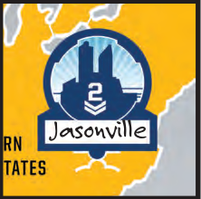
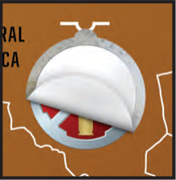
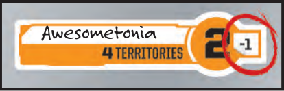
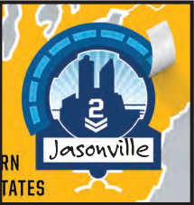
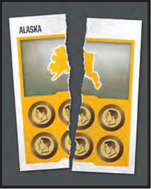
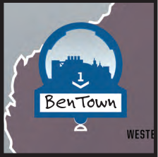
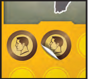

# End of Game

<!-- page 14 -->

As soon as a player has 4 Red Stars, or if all other players are eliminated, the game is over and rewards are given out to the player who won as well as players who held on (weren't eliminated)! The first 15 games played on this board allow both the winner and the factions that held on to change something to set up future wars in this world.

## EVERYONE

All players should turn over their Faction cards and record whether that Faction Won the game, Held On (didn't win but was still in the game), or was Eliminated. If you have no troops on the board when the game ends, you are considered eliminated even if you could've Joined the War on your next turn.

## IF YOU WON

The winner signs his name and dates the next line on the board. Feel free to add any slogans, comments, mottos, or trash talk as appropriate.

After that, the winner gets to do ONE of the following:

<!-- The six rewards are printed in two columns: the first three in the left column, the last three in the right column. -->

- **Name a continent** *(+1 reinforcement for you only).*

  The six continents start out unnamed. You may name any unnamed continent with whatever name you see fit to give it. If you name a continent, then that continent gives you a bonus of one more troop if you control it in future games. For example: You name South America "Awesometonia". On this board, Awesometonia gives a bonus of 2 troops to anyone who controls it but gives you and you alone a +1 bonus for a total of 3 troops. You may put your initials here to remember you named it.

  

- **Name and found a major city** *(2 population).*

  Take one of the five Major City marks and place it in any territory that does not already contain a city. Name that city. In future games there will be a Major City there, worth a population of 2, and this territory is now considered a legal starting territory for you and you alone. You may put your initials here to remember you founded it.

  

- **Cancel a Scar** *(Scar is destroyed).*

  Take one of the four 'white' stickers and place it over any of the Scars that have been placed on the board. This territory no longer has a Scar on it, and a new one can be placed on it in future games. You cannot cancel a city with this reward.

  

- **Change a continent bonus** *(+1 or -1 to that continent forever).*

  

  There are two continent marks in the game — a +1 and a -1 mark. These are placed next to a continent bonus on the board to permanently affect that continent bonus. A continent can only be changed once (either up or down).

- **Place a Fortification mark on a city** *(+1, +1 when defending).*

  Take one of the five Fortification marks and place it on the game board encircling any city, even one that was previously fortified. If you are covering a previous Fortification, all remaining uses on the previous Fortification are ignored. See page 11 for details on Fortification marks.

  

- **Destroy a Territory Card** *(card is destroyed).*

  Sometimes Factions get out of control, and certain areas of the world become too strong. Select any Territory card and DESTROY it. Write a small "x" near that territory's name on the game board to show that it doesn't have a card anymore.

  

  *Note: there are more than 15 winner rewards as part of the game. This means that some will never get put into play.*

<!-- Page 14 art, lower right: concept sketch captioned "Kahn Industries troop concepts". Decorative; not extracted. -->

<!-- page 15 -->

## IF YOU HELD ON BUT DID NOT WIN

As the world changes around them, those Factions that held on can change their standing as well. Proceeding clockwise from the winner, each player who Held On chooses one of the following. Note: if you were eliminated, you do not get to choose one of these options:

- **Name and found a Minor City** *(+1 population).*

  Choose a territory you controlled at the end of the game that does not already contain a city. Take one of the nine Minor City marks and place it in that territory. Name that city. In future games there will be a Minor City there, worth a population of 1.

  

- **Upgrade a card** *(+1 resource)*

  Choose a territory you controlled at the end of the game and find its matching Territory card. Add one resource sticker to it. In future games, the resource value of this card will be worth one more. Note: A Territory card can have no more than 6 total resources on it between starting resources and Resource stickers added, and you cannot place a Resource sticker on a Coin card.

  

- If there are no more Coins or Minor Cities to place, the losers no longer gain any additional rewards.

## COMPLETED WORLD

At the conclusion of the 15th game, once all rewards are chosen, the player who signed the victor's section of the board the most times gets to name the planet! Fill in the section on the board under: "The World Of" with the name of the world you have created. If players are tied for most wins, those tied players roll off, adding 1 to their die roll for each continent they have named. After 15 games, no further changes are made to the game from Winning or Holding On. The game is now played in a world entirely of the players' making. Other elements in the game, such as cards, new components, Scars, etc. will still change the world.

<!-- Page 15 art, bottom left: concept sketch captioned "Kahn Industries HQ concepts". Decorative; not extracted. The right column of page 15 is the "Opening New Packages" panel (see 11-opening-new-packages.md). -->
